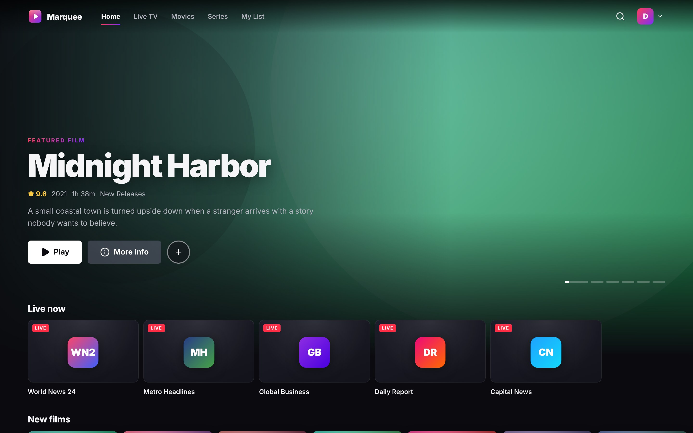
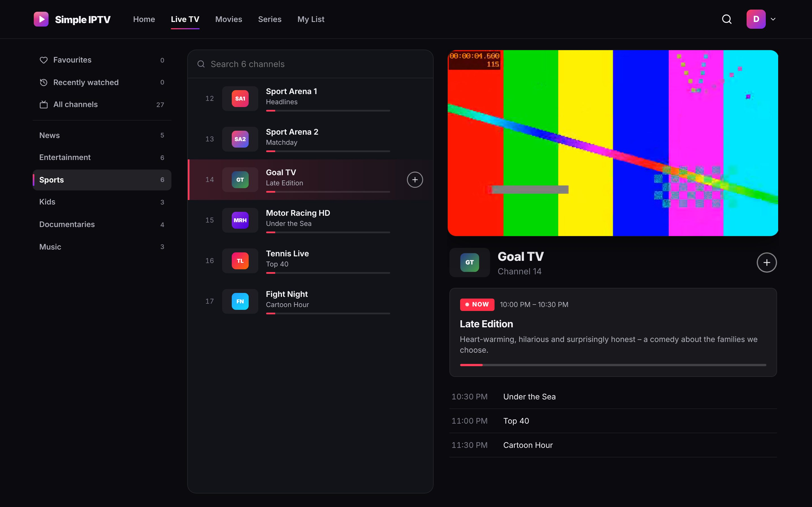
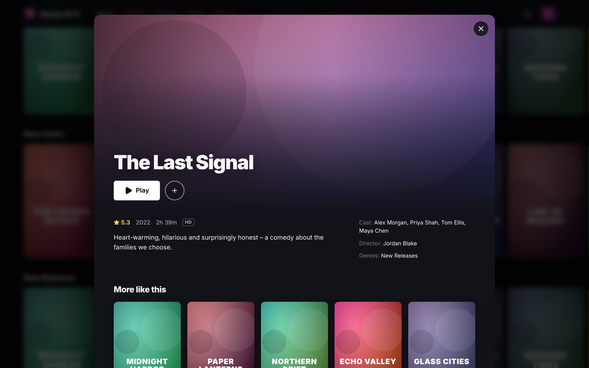
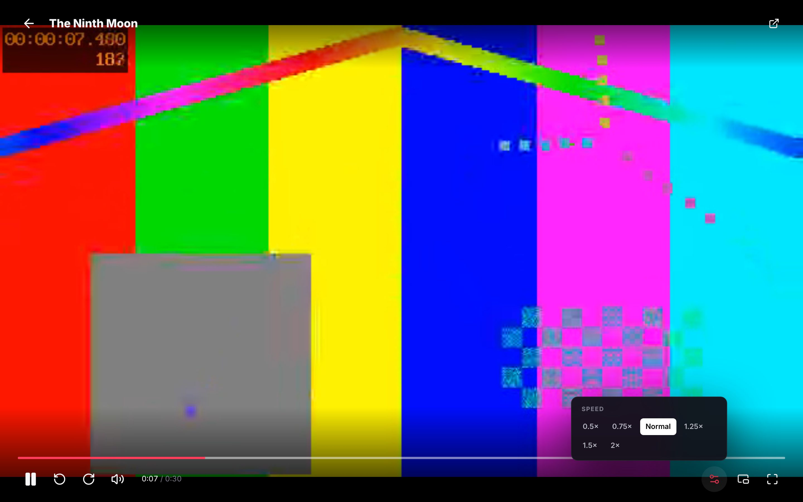

# Marquee

A fast, minimal desktop IPTV player with a Netflix / BBC iPlayer-style interface. Built with **Tauri 2**, **React 19** and a small **Rust streaming proxy**.



## Features

- **Sources:** Xtream Codes (server, username, password) and M3U / M3U8 playlists (URL or local file). You can add several playlists and switch between them. There's also a built-in demo catalogue.
- **Categories:** live, film and series categories with counts, a category filter, sorting (recently added, A–Z, top rated) and a virtualised grid that stays smooth with 50k+ titles.
- **Live TV guide:** channel list with now/next programme info, a live preview window, favourites, recently watched, and channel zapping with ↑/↓.
- **Films & series:** billboard hero, carousels, a details panel (plot, cast, rating), season/episode browser, *Continue watching*, resume, and autoplay of the next episode.
- **Player:** custom controls (seek with preview time, ±10 s, volume, speed), quality, audio and subtitle selection (HLS), picture-in-picture, fullscreen, auto-hiding UI and keyboard shortcuts. A button hands the stream to VLC/mpv/IINA for codecs the WebView can't decode.
- **Fast streaming:** hls.js for HLS and mpegts.js for raw MPEG-TS, both loaded on demand. If one format fails it falls back to the other (`.ts` → `.m3u8`) automatically.
- **Local Rust proxy:** adds CORS, follows redirects, forwards `Range` for seeking, rewrites HLS playlists and sends a configurable User-Agent. It only listens on `127.0.0.1` and every request needs a random per-launch token.
- **Caching:** the catalogue is cached in IndexedDB, so the app opens instantly and refreshes in the background every 12 hours.

| Live TV | Details | Player |
| --- | --- | --- |
|  |  |  |

## Getting started

Prerequisites: [Rust](https://rustup.rs), Node 22+, pnpm 10, and the [Tauri system dependencies](https://v2.tauri.app/start/prerequisites/) for your OS.

```bash
pnpm install
pnpm tauri dev        # run the desktop app with hot reload
pnpm tauri build      # produce installers in src-tauri/target/release/bundle
```

`pnpm dev` runs the UI in a normal browser. Demo mode and M3U work there; Xtream servers usually need the desktop app because of CORS.

## Testing

| Layer | Command | What it covers |
| --- | --- | --- |
| Unit (TS) | `pnpm test` | M3U parser, URL normalisation, formatting helpers (Vitest) |
| Unit + integration (Rust) | `cargo test --manifest-path src-tauri/Cargo.toml` | M3U parser, HLS rewriting, proxy over real HTTP (token guard, CORS, Range, redirects, User-Agent) |
| E2E · UI | `pnpm test:e2e` | 20 Playwright scenarios against a mock Xtream/M3U server with real VP9/Opus streams: sign-in, catalogue, live guide, TS→HLS fallback, zapping, VOD seek/resume, series, search, My List, settings, persistence |
| E2E · desktop app | `pnpm e2e:app` | The compiled Tauri binary driven by WebdriverIO + `tauri-driver`: sign-in through the Rust proxy, live and VOD playback in the real WebView, session restore |

The mock provider (`e2e/support/mock-server.mjs`, credentials `demo` / `secret`) is useful during development too: `pnpm mock-server`, then sign in with server `http://127.0.0.1:4599`. Test media is generated with `ffmpeg` on first run.

App E2E prerequisites (Linux): `webkit2gtk-driver`, `xvfb`, GStreamer plugins (`good`, `bad`, `libav`), and `cargo install tauri-driver`. Run it headless with `xvfb-run -a pnpm e2e:app`.

## Branching & release flow

```
feature/* ─┐
fix/*     ─┼─▶ develop ──(PR)──▶ main ──(tag vX.Y.Z)──▶ GitHub Release
hotfix/*  ─┴───────────────────▶ main
```

| Branch | Purpose |
| --- | --- |
| `main` | Always releasable. Protected; changes arrive by PR from `develop` or `hotfix/*`. |
| `develop` | Integration branch. Feature and fix PRs target this. Dependabot PRs land here. |
| `feature/*`, `fix/*` | Short-lived work branches off `develop`. |
| `hotfix/*` | Urgent fixes off `main`, merged back into `main` and `develop`. |

**CI** (`.github/workflows/ci.yml`) runs on every push and PR to `main` and `develop`: typecheck, unit tests and build; Rust fmt, clippy (`-D warnings`) and tests on Linux, Windows and macOS; Playwright E2E; and desktop-app E2E.

**Releases** (`.github/workflows/release.yml`) are fully automated. To cut one:

```bash
git checkout main && git pull
git tag v1.0.0
git push origin v1.0.0
```

The workflow then:

1. verifies the tagged commit (typecheck, unit tests, build),
2. creates a draft release with auto-generated notes,
3. builds installers in parallel: macOS (Apple Silicon and Intel `.dmg`/`.app`), Windows (`.msi`, NSIS `.exe`) and Linux x64/arm64 (`.deb`, `.rpm`, `.AppImage`),
4. publishes the release.

The version is taken from the tag (`scripts/set-version.mjs`), so you never edit version numbers by hand. Tags with a suffix (`v1.1.0-beta.1`) become pre-releases.

**Dry run:** to check that every platform packages correctly without publishing anything, go to Actions → **Build installers** → *Run workflow*. The installers are attached to that run as downloadable artifacts.

### Optional: code signing

Builds are unsigned by default. On macOS, run `xattr -cr "/Applications/Marquee.app"` after installing. To sign, add these repository secrets and pass them as `env` to the `tauri-action` step: `APPLE_CERTIFICATE`, `APPLE_CERTIFICATE_PASSWORD`, `APPLE_SIGNING_IDENTITY`, `APPLE_ID`, `APPLE_PASSWORD`, `APPLE_TEAM_ID` (macOS), or a Windows certificate (see the [Tauri signing docs](https://v2.tauri.app/distribute/sign/)).

## Keyboard shortcuts

| Key | Action |
| --- | --- |
| Space / K | Play / pause |
| F / double-click | Fullscreen |
| M | Mute |
| ← / → | Seek 10 s |
| ↑ / ↓ | Volume (films), channel up/down (live) |
| N | Next episode |
| Esc | Exit fullscreen / close player |
| Ctrl/⌘ + F | Search |

## Project layout

```
src/                 React UI
  components/        cards, rows, hero, details modal, player
  pages/             Home, Live TV, Browse, Search, My List, Settings, Onboarding
  providers/         Xtream, M3U and demo catalogue adapters
  lib/engine.ts      hls.js / mpegts.js / native playback with fallback
  store/             zustand state, catalogue index & search
src-tauri/src/
  proxy.rs           local streaming proxy (axum + reqwest)
  m3u.rs             fast M3U parser
  external.rs        launch VLC / mpv / IINA
e2e/                 Playwright specs + mock IPTV server
e2e-tauri/           WebdriverIO specs for the real app
```

## Notes

- Codec support depends on the system WebView: WebView2 (Windows), WKWebView (macOS), WebKitGTK (Linux). H.264/AAC plays everywhere. For HEVC, AC-3 and similar, use **Open in VLC / mpv**.
- Credentials are stored locally on your device only.

## License

MIT
